<div align="center">

# fitpath

### Will this sofa go through that door?

A geometry engine that answers it for real furniture and real corridors — and
when the answer is no, says exactly what is in the way.


## ▶ [Open the live demo](https://chanafroind-sys.github.io/fitpath/)

**[See it inside a shop](https://chanafroind-sys.github.io/fitpath/store/products/corner-sofa.html)** ·
**[Read how the engine works](packages/engine/README.md)**

<br>

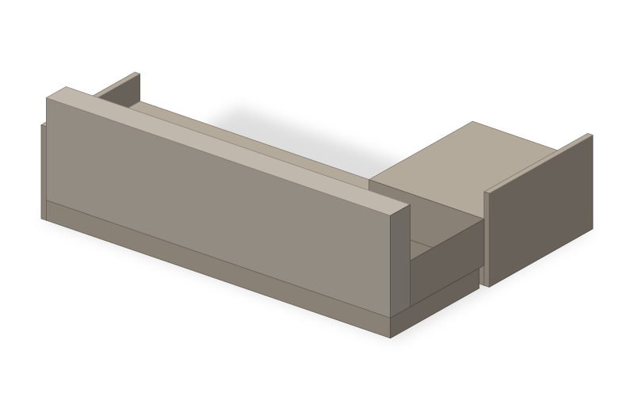

<em><b>280 × 200 cm of corner sofa, modelled as seven oriented boxes.</b> The
picture is drawn from those boxes, at build time, by the same model the
collision test uses — so it can never show a sofa the engine is not reasoning
about. No ordinary doorway takes this one in a single piece, and that is
exactly where a fit check has to be more than arithmetic.</em>

</div>

---

## It is not a doorway calculator

A doorway calculator compares three numbers to three numbers. Here is what that
misses:

> A 220 × 95 × 85 cm sofa. A 110 cm doorway — comfortably wide enough, and any
> calculator will say so. But the corridor in front of that door is 100 cm deep,
> so the sofa can never be turned to face the opening. It does not go in, and
> **making the door wider does not help.**

fitpath searches the actual motion. For that scene it reports that the
**hallway** is the binding constraint and that it would need **177 cm** — a
number it gets by re-planning the scene, never by guessing. Then it says the
move in words, in English and Hebrew:

> Tilt the front edge up about 35° · להטות את הקצה הקדמי כלפי מעלה בערך 35°

---

## The idea the whole thing is built on

The obvious design is the one this project started with: take the shopper's
doorway, hand it to a planner, search for a path. It is also the wrong one, and
the demo shows why — a general A\* over positions and orientations examined
**1,200,000 states** for one doorway and came back having proved nothing at all.

<div align="center">
  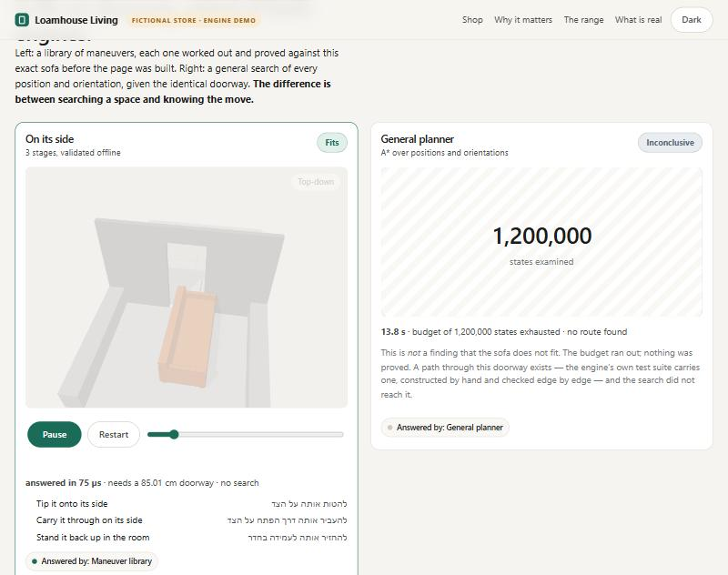
  <br><sub>Left: a validated way in, answered in <b>75 µs</b> with no search at all. Right: the general planner on the identical doorway — <b>1,200,000 states</b>, 13.8 s, no route, and nothing proved.</sub>
</div>

**So the question was turned around.** Instead of searching for one shopper's
door, the engine works out, once per sofa and offline, *every* way that sofa can
go in — and measures the least each one needs. The shopper's doorway then stops
being a search at all:

| | once per sofa, offline | once per shopper, in the browser |
| --- | --- | --- |
| what happens | build every way in: straight through, on its side, seat first and turning, up on end, leaning into the opening | compare numbers |
| what it costs | seconds per sofa, on a build machine | **microseconds**, 18.7 KB of arithmetic |
| what comes out | a library of motions, each validated placement by placement against the collision test, each **measured** for the minimum it demands: door width and height, floor in front, length along the wall, floor behind, ceiling | the way in whose requirements their numbers meet — and where several do, the one that asks for least |

<div align="center">
  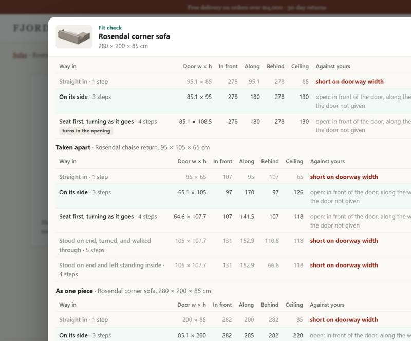
  <br><sub>Every way in, for every body that has to get through, with the minimum each one demands — built before the shopper ever arrived. Choosing one is then a comparison, not a search.</sub>
</div>

That inversion is what makes the rest possible:

- an answer can name **which** motion and **what** it needs, because the motion
  was a thing before the question was asked;
- a "no" is a statement about a finite list that can be read, not the silence of
  a search that ran out of budget;
- nothing heavy runs in a shopper's browser — no planner, no worker, no WebGL
  until there is a motion worth drawing;
- every number on the page was measured against the collider **before the page
  existed**.

---

## What it buys, on the sofa that needs it most

The corner sofa is where the idea earns its keep. As one piece it needs a
**200 cm** doorway — nobody has that — or 85 cm on its side with a door 200 cm
tall and 282 cm of clear floor in front. Taken apart, the two modules it ships
as change the answer completely, and the engine knows both routes because it
built both:

<div align="center">
  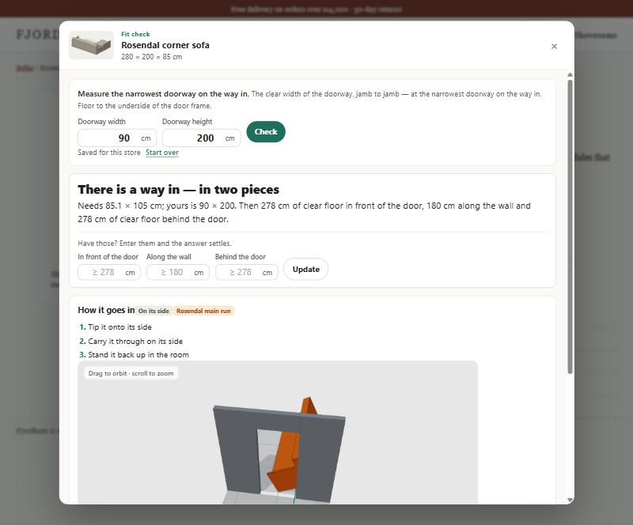
  <br><sub>A 90 × 200 doorway. One piece: no. Two pieces: yes — and the panel says which piece decides it, what the route needs, and shows the motion.</sub>
</div>

| the corner sofa | doorway it needs | in front | along the wall | behind |
| --- | ---: | ---: | ---: | ---: |
| as one piece, carried in level | 200 × 85 cm | 282 | 200 | 282 |
| as one piece, on its side | 85.1 × 200 cm | 282 | 285 | 282 |
| **the main run** (276 cm), on its side | **85.1 × 95 cm** | 278 | 180 | 278 |
| the chaise return (95 cm), seat first | 64.6 × 107.7 cm | 107 | 141.5 | 107 |

Every module has to get through, so the module figure is the **widest** of them,
never the narrowest — and the panel says so rather than quoting the friendlier
number.

---

## The rules it answers by

The geometry is only half of it. A fit check is trusted or not trusted on the
answers it gives when it is *not* sure, so the rules below are set first and
the engineering is built to them — not the other way round.

| the rule | what it forbids |
| --- | --- |
| **Build every way in first, choose afterwards.** The search happens once per sofa, offline; the shopper's doorway only selects | searching for one person's door, and calling that search's failure an answer |
| **Measure first, claim after.** Every number a person sees came from a motion that was validated against the collision test | a rule of thumb, a safety factor, a number nobody can point at |
| **A search that ran out of budget is not a no.** Only a closed-form argument may read as "it will not fit" | the easy lie: 1.2 M states examined, no route found, therefore impossible |
| **Name the family a bound covers, and nothing more.** The 85 cm floor bounds *roll* schedules, not every way of turning a sofa | a true statement quietly widened into a false one |
| **Two lines, not a paragraph.** One verdict line, one line that puts the threshold beside the shopper's own number; everything else behind a disclosure | a shopper reading an essay about our list of maneuvers |
| **Ask for the opening; report the rest.** Width and height together, once. The corridor is stated as what the route needs, never demanded before an answer | an escalating interrogation: one number, then a question, then another |
| **Never quote one maneuver's corridor as the requirement.** Every way in is weighed against what the shopper gave, and a number that rules one out falls back to the next | demanding 222 cm of hallway for a sofa that could have gone in on end |
| **Never depict or assume a modification nobody confirmed.** The legs come off only where the listing says so, and only in the band of doorways where taking them off changes the verdict | a picture of a sofa with its legs removed, shown to someone who never said they come off |
| **Say the wall only when it changes the answer** — and use a wall a house actually has | "holds for any wall up to 100 cm thick", which no home has and no person needs |

Each of those is enforced somewhere a test can see it: the verdict logic is
pure and separately tested, every shopper-facing string lives in one module,
and the tests assert the *shape* of what is said so that rewriting the wording
can never quietly change the meaning.

---

## The part nobody wrote down

<div align="center">

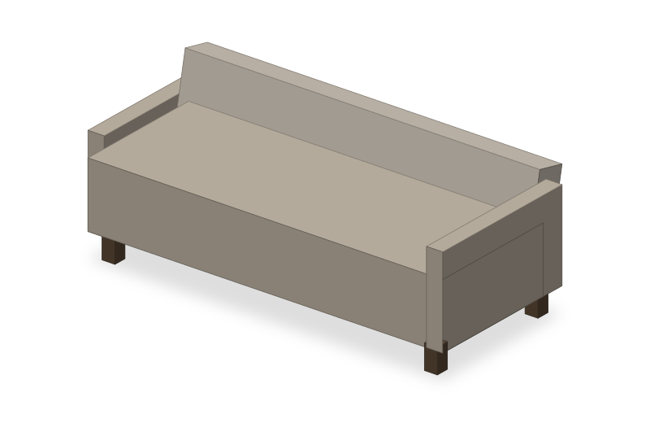

</div>

Building *every* way in raises a question a path search never has to answer:
when is the list finished? For the three-seater it held carry it straight in,
tip it on its side, lead with the seat and turn as it goes, stand it on end —
each validated, each measured. Then the engine was asked how narrow a doorway
could be over **every** way of rolling the sofa as it travels. That minimax
says **85.00 cm**, and the library reached it exactly. A satisfying place to
stop.

The rule about naming the family a bound covers is what stopped it being the
end: a floor over *roll* schedules is not a floor over every way of turning a
sofa, and treating it as one would have been the overclaim this project exists
to avoid. So the question was asked again, properly — and there is a motion
that *leans* the sofa into the doorway and straightens it inside, which gets
the same sofa through **82.74 cm**, 2.3 cm under a floor that had looked final.

<div align="center">

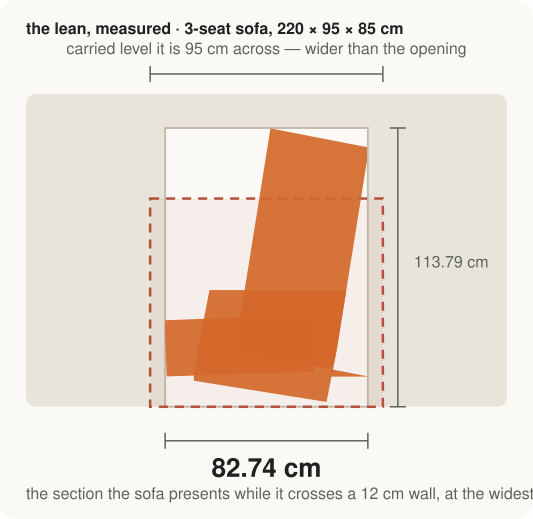

<em>Measured, not drawn. The orange shape is the sofa's real section as it
crosses the wall, read out of the motion the product ships. Carried level the
same sofa is 95&nbsp;cm across and does not go; leaning, it needs
82.74&nbsp;cm.</em>

</div>

The planner could never have found it, and the reason is architectural rather
than a matter of budget: a placement in its search space carries one tilt, and
the lean needs a roll **and** a pitch at the same time. The motion was not hard
to find — it was never there to be found. So it is a library maneuver now, with
a roll on the placement that is validated and animated but never searched, and
the honesty travels with it: a **measured witness, not a proof of a floor**.

<sub>The full account, with the planner's node counts and what each run proved,
is in the engine's README under *The lean, in the library*.</sub>

---

## It never claims more than it knows

Four different answers, and the difference between them is the whole point:

| the answer | what it means | what establishes it |
| --- | --- | --- |
| **Fits** | a validated motion whose every requirement your numbers meet | a comparison against a motion checked offline, placement by placement |
| **There is a way in** | the doorway is enough; here is what the rest of the route must be | the same comparison, with the unmeasured requirements reported, not assumed |
| **No known way in** | our list has nothing for these numbers — *a fact about the list* | every maneuver ruled out by a number you actually gave |
| **Won't fit — proven** | geometrically impossible at any angle whatsoever | a closed-form argument per box, with no search in it |

A search that ran out of budget is **never** reported as a no. The only
negative allowed to read as a verdict is the closed-form one, and the interface
says so in one small line rather than a paragraph.

---

## The product: one script tag

A shop adds this to a product page and nothing else:

```html
<script async src="https://cdn.example/fitpath/fitpath.js"></script>
```

It finds the product, puts a **Will it fit through my door?** button beside the
buy control, and does nothing further until someone presses it. Everything
renders inside a shadow root, so the shop's stylesheet cannot reach it and it
cannot reach the shop's.

| loaded | when | gzipped |
| --- | --- | ---: |
| the button | with the page | **1.6 KB** |
| the fit check, with the engine functions it calls | on first press | 18.7 KB |
| one product's library of ways in | on first press | ~2–3 KB |
| the 3D view | only when there is a motion to draw | 120 KB |

A shopper whose door is too narrow never pays for the 3D.

<div align="center">
<a href="https://chanafroind-sys.github.io/fitpath/store/products/corner-sofa.html"><b>→ Try it on a product page</b></a>
</div>

<div align="center">
  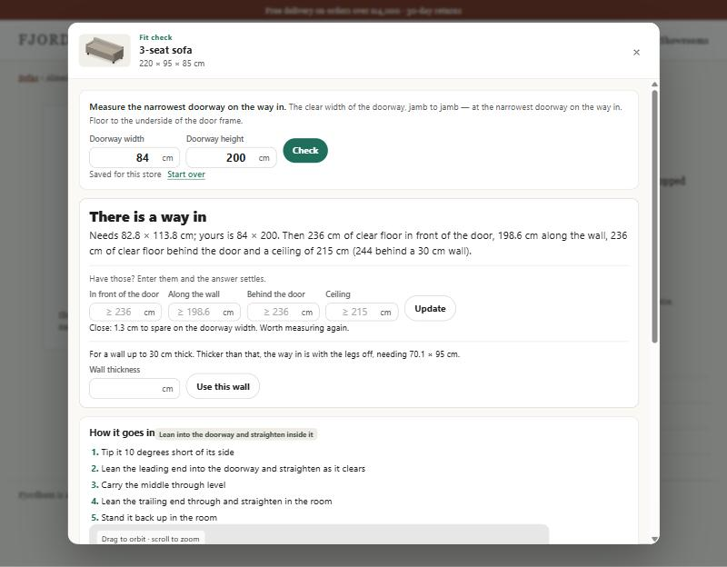
  <br><sub>One verdict line, one supporting line that puts the threshold beside the shopper&rsquo;s own number. Everything else — the other ways in, the floor, the fine print — is one disclosure away.</sub>
  <br><br>
  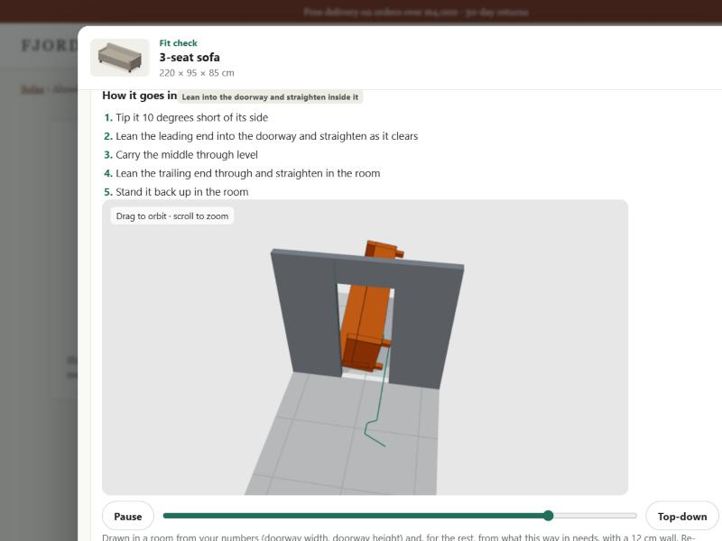
  <br><sub>The motion itself, in five steps and in 3D — re-checked against the collision test in that exact room before it is drawn.</sub>
</div>

---

## The catalogue, measured

Six sofas, each modelled as a handful of oriented boxes. Every figure in the
third column was measured from a validated motion — never estimated, never a
rule of thumb:

| sofa | as drawn | narrowest doorway it needs | every roll schedule could reach |
| --- | --- | ---: | ---: |
| 3-seat sofa | 220 × 95 × 85 | **82.74** cm — by leaning | 85.00 |
| Vetle slim-arm 2-seat | 160 × 90 × 80 | **77.79** cm | 77.76 |
| Havsta deep-seat lounge | 210 × 110 × 75 | **75.01** cm | 75.00 |
| Lindholm sofa bed | 200 × 100 × 90 | **90.01** cm | 90.00 |
| Brekke 2-seat recliner | 180 × 100 × 105 | **100.00** cm | 100.00 |
| Rosendal corner sofa | 280 × 200 × 85 | **85.01** cm assembled | 85.00 |
| ⤷ in its two modules | 276 and 95 long | **85.01** cm — the main run decides | — |

<div align="center">
  
  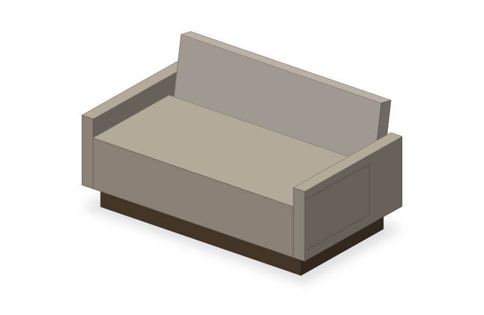
  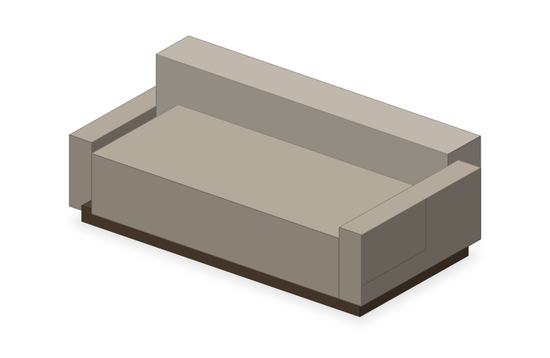
  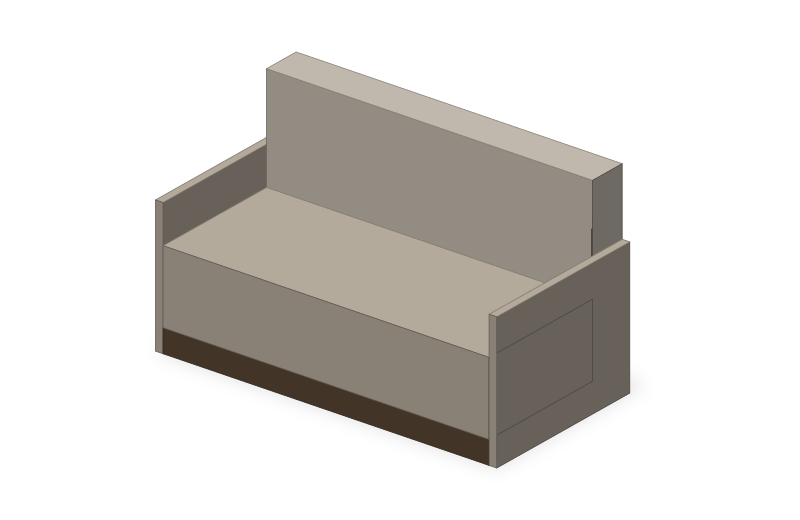
  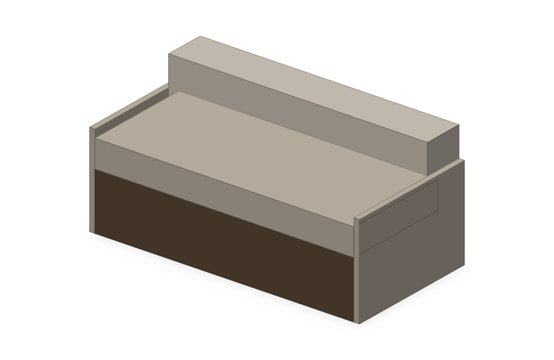
  <br><sub>Not renders, not photographs: each one is its own box model, drawn at build time.</sub>
</div>

The last column is a minimax over roll schedules: the narrowest doorway any way
of *rolling* the item as it travels could manage. It bounds nothing that leans
or turns the sofa inside the doorway — which is exactly how the three-seater
goes under it.

---

## Inside the repository

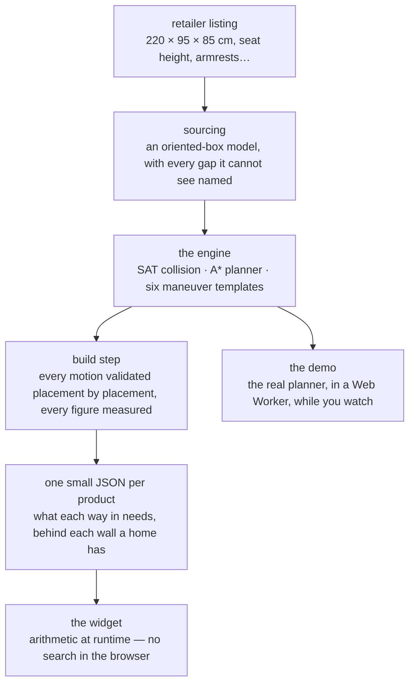

| | |
| --- | --- |
| [`packages/engine`](packages/engine) | the geometry: collision, planner, maneuver library, diagnostics, the sourcing pipeline. **Start with [its README](packages/engine/README.md)** — it is the real document here |
| [`packages/viewer`](packages/viewer) | the engine's scenes drawn in Three.js, shared by both apps |
| [`packages/illustrate`](packages/illustrate) | a product picture drawn from an item's box model at build time |
| [`apps/widget`](apps/widget) | the fit check as a store adds it: one script tag |
| [`apps/store`](apps/store) | a fictional shop that embeds it, exactly as a real one would |
| [`apps/demo`](apps/demo) | the engine demo: the planner running in the browser while you watch |

Every app is a *consumer* of the engine, never a copy of it. The widget calls
the engine's own `provableNoFit`, `selectManeuver` and `verifyPathIn` at
runtime, and re-checks the motion in the shopper's own room before drawing it.

---

## Run it

```bash
npm install
npm test          # the engine, the illustrator and the widget
npm run build     # the widget, the store that embeds it, and the demo
npm run bench     # the planner, measured
```

Node 24 or newer: the sources run under native TypeScript type stripping, so
there is no build step to run first. The figures in this file are generated by
`node docs/make-figures.ts`, from the same data the product ships.

## Invariants

Recorded in [CLAUDE.md](CLAUDE.md) and enforced by the tests:

- the geometry engine has **no DOM, no canvas, no framework** — it runs in Node;
- **no physics engine, ever.** The collision detection (SAT) is ours;
- the planner is **deterministic** — same input, same path, no randomness;
- every degenerate case gets a **named test before it gets a fix**;
- **zero runtime dependencies** in the engine.

## Licence

MIT.
